# gh-night-city

Your GitHub contribution graph as a lofi night city.

<picture>
  <source media="(prefers-color-scheme: dark)" srcset="assets/preview-dark.svg">
  
</picture>

Your contribution squares sit at the bottom like the city's street lights. At dusk a skyline rises behind them (one building per week, as tall as that week's total), the lights go out and come back on week by week, and the last train carries someone with headphones and a laptop slowly across the city while a rooftop billboard scrolls `coding 24/7`. At dawn it sinks back to just your squares. The loop is about 23 seconds.

It's a GitHub Action that writes two animated SVGs, one for dark mode and one for light mode. They're plain SVG with CSS animation, no scripts or web fonts, so they work as README images.

## Quick start

1. In your profile repository (the one named after your username), add [`examples/profile-workflow.yml`](examples/profile-workflow.yml) as `.github/workflows/night-city.yml`.
2. Run it once from the Actions tab (**Night city**, then **Run workflow**). It publishes `night-city-dark.svg` and `night-city-light.svg` to a `night-city` branch, and refreshes them daily.
3. Add this to your `README.md`, replacing `<you>` with your username:

```html
<picture>
  <source media="(prefers-color-scheme: dark)" srcset="https://raw.githubusercontent.com/<you>/<you>/night-city/night-city-dark.svg">
  /<you>/night-city/night-city-light.svg" width="100%" alt="Contribution graph as a lofi night city">
</picture>
```

## Inputs

| Input | Default | Description |
|---|---|---|
| `github-token` | `${{ github.token }}` | Token used to read the contribution calendar. The built-in token counts public contributions only; see below for private ones. |
| `username` | the repository owner | Whose contribution calendar to draw. |
| `output-dir` | `dist` | Where `night-city-dark.svg` and `night-city-light.svg` are written. |
| `sign-text` | `coding 24/7` | Text that scrolls across the rooftop billboard. Up to 40 characters, drawn in JetBrains Mono; characters the font doesn't have (such as emoji) fail the run with a message saying which one. |

## Private contributions

To count private contributions, create a personal access token (a classic token with the `read:user` scope is enough), save it as a repository secret such as `NIGHT_CITY_TOKEN`, and pass it as `github-token: ${{ secrets.NIGHT_CITY_TOKEN }}`. Only daily counts are drawn, never repository names. Private contributions also need to be visible on your profile (**Settings**, then **Public profile**, then **Include private contributions on my profile**).

## Preview locally

From a clone of this repository:

```sh
npm ci
GITHUB_TOKEN=<a token> npm run preview -- --user <you> --out out --sign-text "coding 24/7"
```

Open `out/night-city-dark.svg` in a browser. `npm run render-sample` renders the bundled sample data instead and writes a side-by-side comparison with the original design mock to `out/compare.html` (serve `out/` with any static file server to use it).

## Credits

The billboard text uses [JetBrains Mono](https://www.jetbrains.com/lp/mono/), licensed under the SIL Open Font License 1.1 (see [`THIRD_PARTY_NOTICES.md`](THIRD_PARTY_NOTICES.md)). Made by [Francis](https://github.com/franc1sjacob). MIT licensed.
